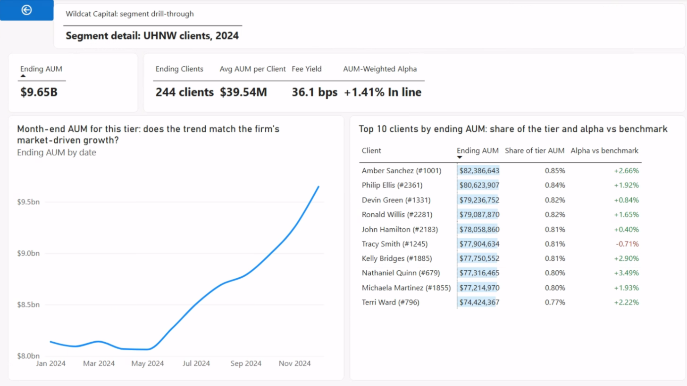

# Design critique with Claude (Part E)

**How I ran it:** I gave Claude the two page screenshots (`dashboard/page1.png`, `dashboard/page2.png`), the audience (Wildcat's managing director) and the business question ("Where did 2024 growth come from, markets or new money, and which segments and regions drove it?"). I asked for a critique against the Week 11 checklist (clear question, insight titles, right chart for the data, sorting, one accent color, bars from zero, accessible color, labels, clutter) and the top three changes.

## Claude's top three changes

1. Fix the clipped values on the Page 2 cards (the numbers are cut off at the bottom).
2. Make the small net-flows parts readable in the tier and region bars (for UHNW and HNW the navy part is only a few pixels wide).
3. Turn the Page 2 chart titles into findings, like on Page 1, instead of questions or labels.

## Suggestions log

| # | Claude's suggestion | Decision | Reason |
|---|---|---|---|
| 1 | Page 2 KPI values are clipped at the bottom of the cards ("$9.65B" and "244 clients" are cut off), so the most important numbers on the page are hard to read | **Accept** | Fixed: raised both card visuals to 110 px and set the value font to 16. See before/after below |
| 2 | Waterfall labels are in $M ("$2,007.09M") but the cards are in $B ("$2.01B"); use one unit | **Reject** | In $B the net-flows step would read "$0.08B", which hides the point of the chart (new money is small but not zero). The cards stay in $B for size; the chart stays in $M for the split |
| 3 | The UHNW and HNW net-flows parts are too thin to see; add a separate % label or a 100% stacked version | **Adapt** | I kept dollar bars, because the size difference between tiers is part of the answer. The **dynamic title** already gives the share ("Retail clients: 52% of their growth vs. 4% overall"), and the tooltip shows Net Flows for every bar |
| 4 | Page 2 trend title is a question ("does the trend match…?"), not an insight | **Adapt** | Kept the question for now, because Page 2 changes with whichever tier you drill into, and a fixed sentence would be wrong for some tiers. The subtitle names the tier and year. A dynamic trend title (e.g. "UHNW AUM +19.6% in 2024, most of it after May") is the next improvement |
| 5 | The headline and KPI "cards" are table visuals, so they show a sort arrow and a scrollbar; use the Card visual | **Reject** | The Card and new Card visuals render as blank boxes in Power BI Desktop on Apporto (same issue as HW6), so tables with text measures are the workaround. The values are correct and reconciled |
| 6 | Only one accent color is used (navy = net new money, grey = everything else), and bars start at zero and are sorted | **Keep** (no change) | Matches the Week 11 checklist |
| 7 | Put the Market Change caveat closer to the Market Change card | **Reject** | It runs along the bottom under all three charts, because it explains the grey part of every chart, not just the card. It's in the reading path after the charts |

## One claim Claude made that was wrong

When Claude built the top-10 table on Page 2, its **Total** row said the top 10 clients held **$12,729,572,079** and **100.00%** of the tier. That's wrong. It's the whole firm's AUM, because at the total level the rank measure doesn't filter to 10 clients. The real top 10 are each under 1% of the tier (for UHNW, $82.4M = 0.85% for the largest). Claude didn't catch it in its own build. I turned the total row off, so the table can't show the whole tier's AUM under a "top 10" title. This is also noted in the README filter audit.

## Before / after (suggestion 1)

**Before:** the values on the Page 2 cards are cut off at the bottom.

**After:** the cards are 110 px tall with a 16 pt value font, so every value is fully visible.

